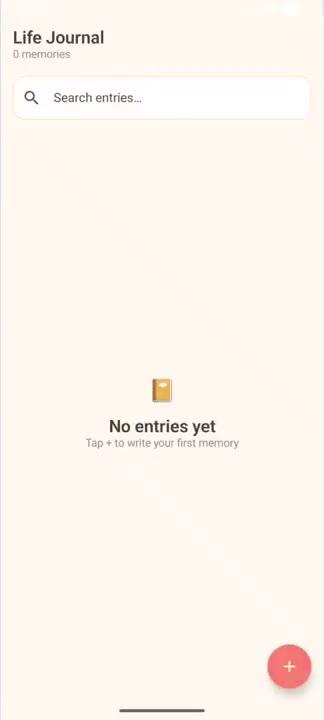
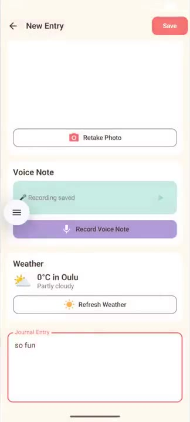

# Life Journal

An Android journaling app that saves the whole moment, not just the words. Each entry can hold a mood, a photo from the camera, a recorded voice note and the live weather in Oulu.

<p align="center">
  
</p>

| Home | Camera | Finished entry |
|---|---|---|
|  |  |  |

## Features

- **Write an entry** with a title, text and a mood picked from emoji
- **Take a photo** with the phone's camera and attach it to the entry
- **Record a voice note** and play it back
- **Fetch the live weather** for Oulu (temperature and conditions) from the [Open-Meteo](https://open-meteo.com/) API, with no API key needed
- **Search** all entries as you type
- **View and delete** entries; everything is stored offline on the device

## Tech stack

| Area | Used |
|---|---|
| Language | Kotlin |
| UI | Jetpack Compose, Material 3, Navigation Compose |
| Architecture | MVVM: `JournalViewModel` → `JournalRepository` → Room DAO |
| Storage | Room (SQLite), Kotlin Flow for live updates and search |
| Networking | Open-Meteo REST API, parsed with `org.json`, run on coroutines |
| Media | System camera via `TakePicture` + `FileProvider`, `MediaRecorder` / `MediaPlayer`, Coil for images |
| Build | Gradle (Kotlin DSL), min SDK 26, target SDK 35, JVM 17 |

## Project structure

```
app/src/main/java/com/example/lifejournal/
├── MainActivity.kt          # app entry point and navigation (home, create, view)
├── WeatherApi.kt            # Open-Meteo request and weather code → text/icon
├── audio/AudioRecorder.kt   # record and play voice notes
├── data/
│   ├── JournalEntry.kt      # Room entity
│   ├── JournalDao.kt        # queries, including search
│   ├── JournalDatabase.kt
│   ├── JournalRepository.kt
│   └── JournalViewModel.kt  # entries, search query, insert and delete
└── ui/screens/              # HomeScreen, CreateEntryScreen, ViewEntryScreen
```

## Run it

1. Clone the repo and open it in Android Studio.
2. Let Gradle sync, then run the `app` configuration on an emulator or phone (Android 8.0+).
3. Allow camera and microphone access when the app asks, and make sure the device is online to fetch the weather.

## Author

Built by **Dinara Uralboeva**, Computer Science & Engineering student at the University of Oulu.
Portfolio: [uralboevad.github.io](https://uralboevad.github.io) · [LinkedIn](https://www.linkedin.com/in/dinara-uralboeva)
